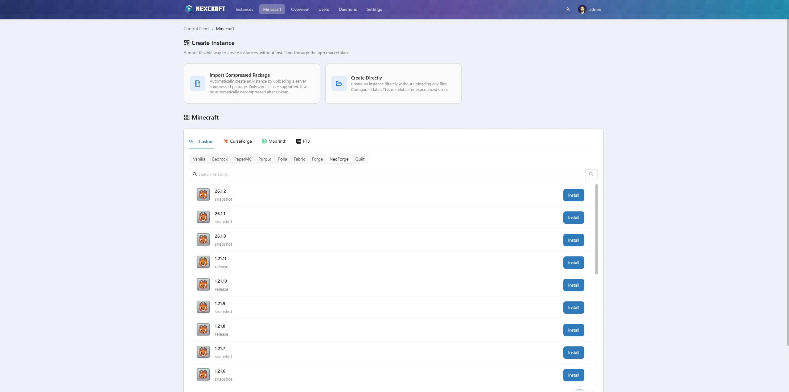
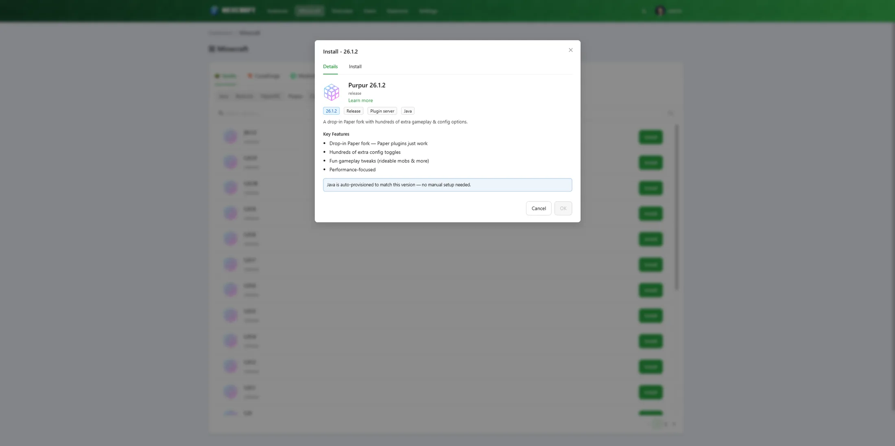
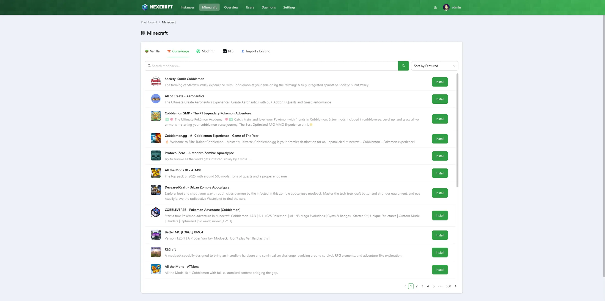
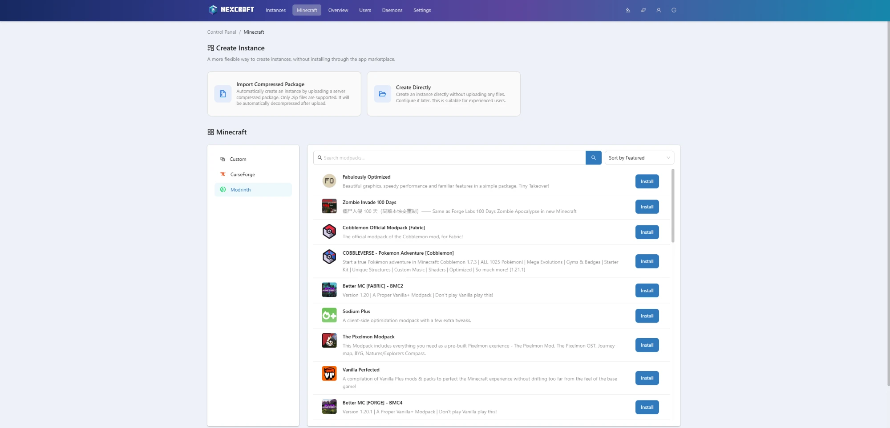
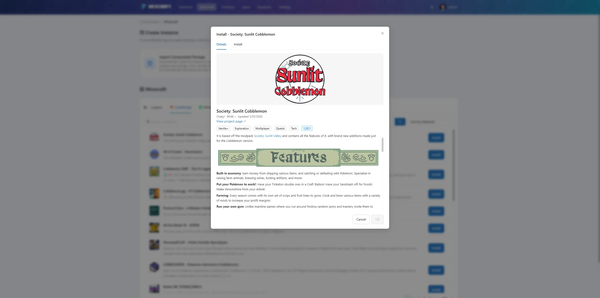
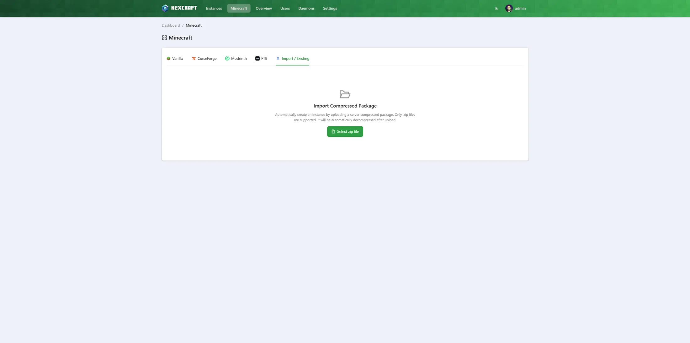

# Creating Minecraft Servers

NexCraft replaces the generic app marketplace with a **Prism-Launcher-style Minecraft builder**. Open the **Minecraft** menu (URL `/#/minecraft`) to get started. There are five sources to choose from:

- **Vanilla** — build a fresh server for any Minecraft version, with or without a mod loader.
- **CurseForge** — search and install CurseForge modpacks.
- **Modrinth** — search and install Modrinth modpacks.
- **FTB** — search and install Feed The Beast modpacks.
- **Import / Existing** — upload a server you already have and run it as-is (see [Importing an existing server](#importing-an-existing-server)).

## Vanilla (loaders / server software)

1. Select **Vanilla**.
2. Pick a **mod loader** from the row of icons:
   - **Vanilla** — the official Mojang server.
   - **Paper**, **Purpur**, **Folia** — high-performance server software (downloaded as a ready-to-run jar from their official APIs).
   - **Fabric**, **Forge**, **NeoForge**, **Quilt** — modloaders (the daemon runs the official installer/bootstrap).
3. Choose a **Minecraft version** from the list. Versions are pulled live — Mojang's manifest for Vanilla/loaders, and each project's API for Paper/Purpur/Folia. Tick **Show snapshots** to include non-release versions.
4. Click **Install**, set an **instance name** and **max memory**, optionally choose a **Server Port** (see below), and confirm.

The **Details** tab for each software shows its tags (version, release type, category), a curated **Key Features** list, and a note about the **Java version auto-provisioned** for it.

The daemon downloads the server, runs any loader bootstrap, configures the chosen or automatically assigned port before first start, and writes the start command for you.

## CurseForge / Modrinth / FTB modpacks

1. Select **CurseForge**, **Modrinth**, or **FTB** and search (or browse the popular list).
2. Click a pack to open its detail dialog — description, tags, supported versions, and a **Version** picker.

   
3. Choose a version, accept the **Minecraft EULA**, set memory, optionally choose a **Server Port**, and **Install**.

What happens under the hood:

- **CurseForge:** NexCraft installs the pack's **server pack** file. Packs without a server pack are shown disabled ("no server pack").
- **Modrinth:** NexCraft installs the full **`.mrpack`** server files (mods + overrides).
- **FTB:** NexCraft installs the server files listed in the pack's FTB manifest (server-side mods and configs, downloaded from the FTB CDN).
- The correct **mod loader and version** are resolved automatically from the pack metadata, and a matching **Java** version is provisioned if needed.
- Known **client-only mods** that crash dedicated servers (e.g. `e4mc` shipped in client optimization packs) are stripped automatically.
- A **server icon** is generated from the pack's logo, and the **EULA** is accepted on your behalf.

After install, NexCraft routes you to the instance's console to watch the bootstrap and start the server.

## Choosing a server port

For a **new instance**, the install dialog accepts an optional server port. Leave it **blank** to let NexCraft choose a free port automatically, or enter a whole decimal number:

- **Java:** `1` to `65535`.
- **Bedrock:** `1` to `65534`. Bedrock uses an adjacent UDP pair: your chosen port and the next port, so both must be available.

NexCraft checks ports used by other instances on the node, including stopped instances, other applications, and installations in progress. A conflicting explicit choice is rejected; choose another port or leave the field blank. Java query traffic can share the game port number over UDP; RCON uses a separate TCP port.

The new-port choice applies to new installations, not the Import / Existing flow. Reset/reinstall within the same edition preserves the existing game/query ports and RCON settings rather than assigning new ones. Switching between Java and Bedrock reallocates ports compatible with the destination edition.

After installation, find and copy the configured game address in the **Instances** cards/table or **Basic Info**. See [Game addresses and node hosts](managing-instances.md#game-addresses-and-node-hosts) if the address players use differs from the node's daemon address.

## Importing an existing server

Already have a server folder? Pick the **Import / Existing** source tab, upload it as a `.zip`, and NexCraft auto-detects what it is (Java vs Bedrock, loader, version) and walks you through a review screen before creating the instance. *(Admin only.)*

- **Java** — imported **as-is**: NexCraft runs the uploaded server with its existing world, mods, and configs.
- **Bedrock** — installs the **latest Bedrock Dedicated Server** and keeps your world (version-locked), with an *import-as-is* opt-out. The start command and file permissions are set for you.

## Starting the server

On the instance terminal, click **Start**. NexCraft shows **"Instance is starting…"** while the server boots and only flips to **Running** once the server actually reports it's ready — so the status reflects reality, not just that the process launched.

## Notes

- All servers run in **host / general process mode**. Running servers inside Docker containers is not supported in NexCraft.
- To change a game port later, edit `server.properties` in **Config Files** and restart the server. The displayed configured address can reflect a saved change before the running server has applied it.
- The **start command** is generated for you but is editable under **Instance Settings → Startup Command** if you need to tweak it.
