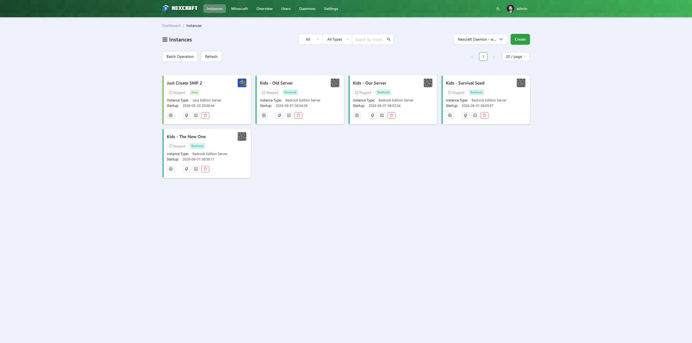
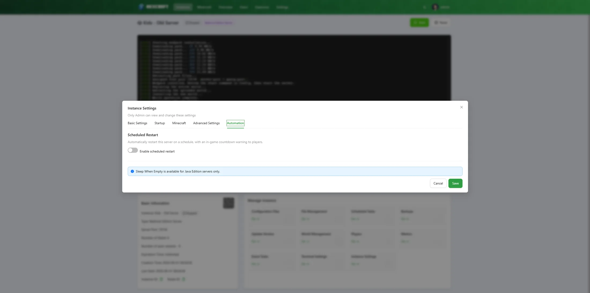
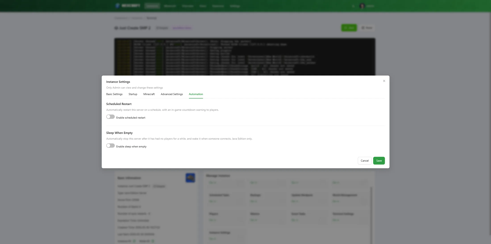
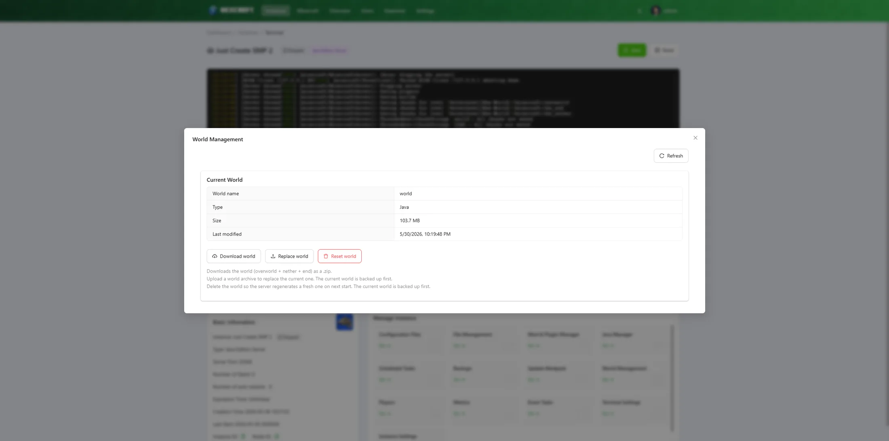
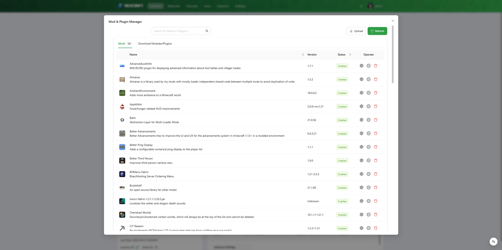
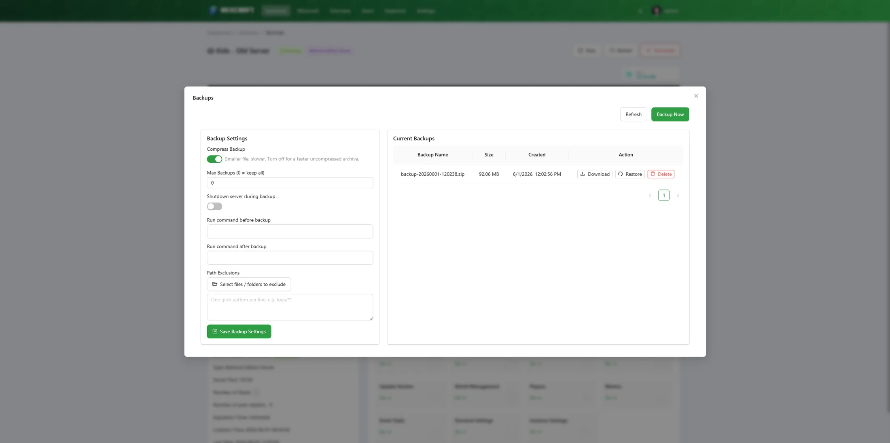
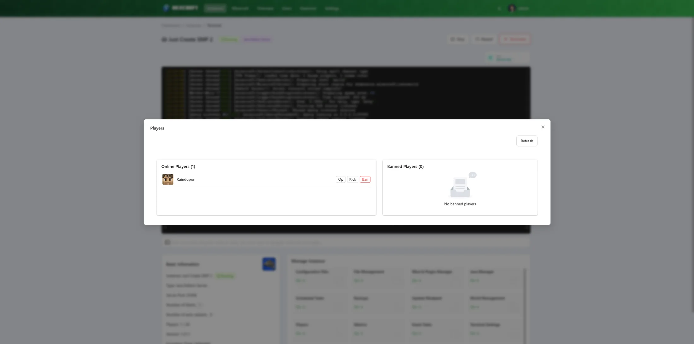
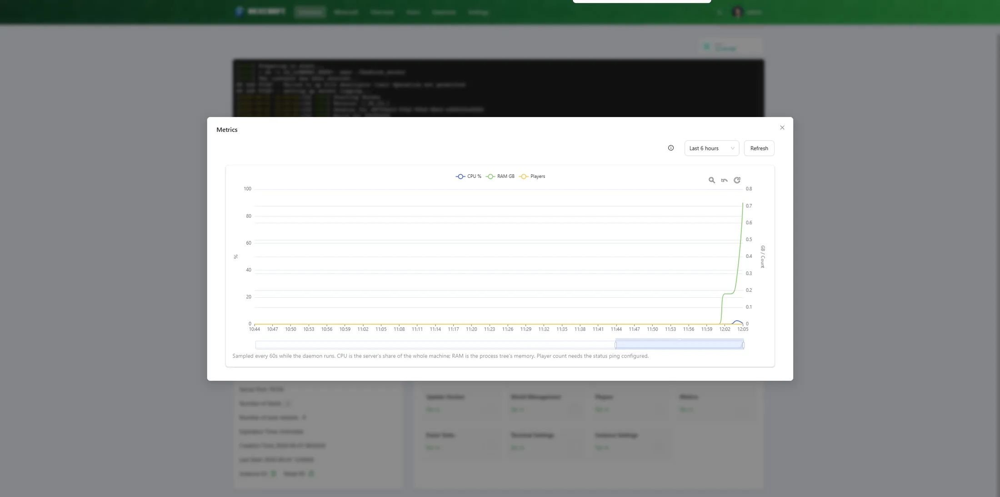
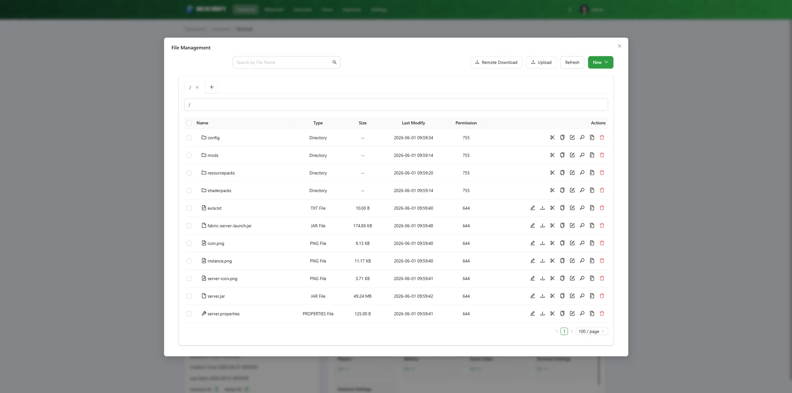
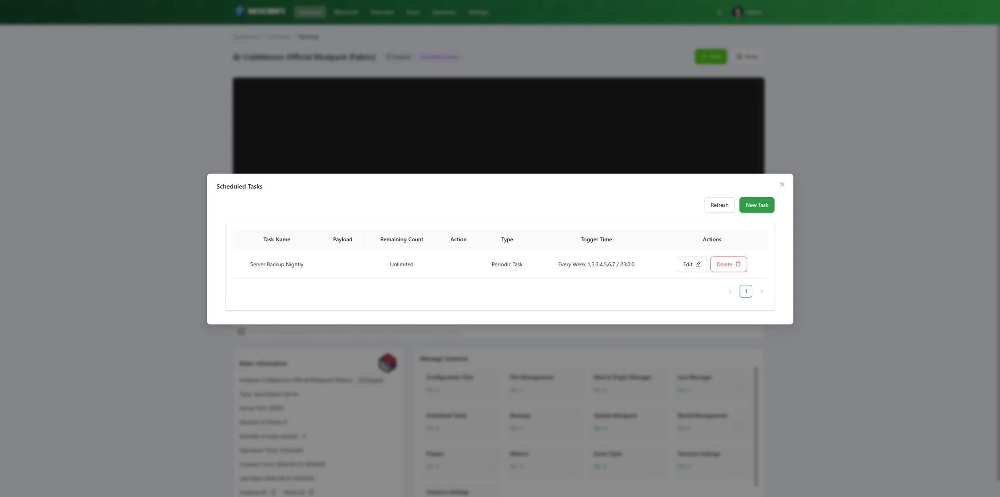

# Managing an Instance

Each instance has a **Manage Instance** grid (full-page features) and an **Instance Settings** dialog (form-style settings). This page covers the NexCraft-specific bits.

## The instances list

Each card shows an **edition badge** and a coloured accent stripe — **green for Java**, **teal for Bedrock** — so you can tell editions apart at a glance. When a node has both, the toolbar gains an **All / Java / Bedrock** filter to narrow the list to one edition (single-node view; the global all-daemons tree shows everything).

## Game addresses and node hosts

The **Instances** cards and table rows, and an instance's **Basic Info**, show a copyable **Server address**. The port comes from that instance's `server.properties`, including for stopped instances. If the configured port is missing or invalid, the address is unavailable rather than guessed.

The normal Unraid setup uses the daemon’s address plus each server’s game port; no address customization is needed.

In node settings, **Player address (optional)** lets you enter a different IP address or hostname only when that is what players use to connect (for example, `play.example.com`). Leave it blank to use this daemon’s address. Enter the address without a port; NexCraft adds each server’s port. Hostnames, IPv4 and IPv6 addresses are supported; URL schemes and paths are not. This field is separate from the daemon host and **RPC port**, which NexCraft uses to manage the node.

For example, a player host of `play.example.com` and configured game port `25565` produce `play.example.com:25565`. IPv6 addresses are displayed and copied with brackets, such as `[2001:db8::1]:25565`. Setting a player host does not configure DNS, forwarding, or the server's listening port.

Addresses show the **configured** port. After editing `server.properties`, restart the server to apply the change; follow the restart hint before sharing a changed address. Reset/reinstall within the same edition preserves existing game/query ports and RCON settings, including the password. Switching between Java and Bedrock reallocates ports compatible with the destination edition.

## Installed versions and updates

Version information keeps the installed **pack version** separate from the **Minecraft version**. Bedrock shows the installed **Bedrock Dedicated Server (BDS) version**. Missing installed metadata is shown as **Unknown**; it is not replaced by the provider's newest release.

Update checks support **CurseForge**, **Modrinth**, and **Bedrock** in the existing update flow. **FTB** update checking is unsupported, so an FTB installation is not marked up to date on that basis. Unknown metadata and failed checks also do not mean the server is up to date.

Successful update checks are cached for **10 minutes**, with simultaneous requests shared, so refreshing the instance list does not force a new provider check each time. When an update is available, use the badge to open the existing **Update** panel and review release notes before updating. Existing administrator permissions still apply.

## Day/night appearance

Use the day/night switch near the profile controls in the desktop or mobile header, or in the sidebar layout. Toggling chooses an explicit light or dark mode based on the current appearance. Use the adjacent mode selector's **System (Auto)** option to follow your device's appearance again.

Your mode choice is saved independently of the colour palette, so changing brightness preserves your selected theme. The switch and mode selector work with the keyboard, and the switch respects reduced-motion preferences.

## Instance Settings

Open **Instance Settings** from the manage grid. The **Basic** tab holds the everyday settings; **Advanced** holds working directory, file encoding, and run-as user.

For Minecraft Java instances, the Basic tab also includes:

### Server MOTD
An easy single-field editor that writes the `motd` line in `server.properties`. Supports `&` colour codes (e.g. `&6Gold &lBold`) and a second line. Applies on the next start.

### Server Icon
Upload an image — it's resized to 64×64 and saved as `server-icon.png` for the server list. (Moved here from the manage grid to keep things tidy.)

### Shutdown Timeout
Seconds to wait after the stop command before NexCraft force-kills the process. `0` = wait indefinitely.

### Startup / Stop Command
The generated start command is editable here; the stop command defaults to `stop` for Minecraft.

### Bedrock servers
Bedrock instances get their own **Minecraft settings** on the Basic tab — **Server Name** and **Level Name** (the active world; changing it switches worlds, so NexCraft warns and asks you to confirm) — plus the **Set Server Icon** picker.

## Event Tasks (auto start / restart)

In **Event Tasks** you can enable:

- **Auto Restart** — restart the instance immediately if it stops unexpectedly (optionally capped to N times).
- **Auto Start** — start the instance when the daemon boots, with a configurable **Autostart Delay** (seconds) so multiple servers don't all spin up at once.

## Automation

The **Automation** tab adds two hands-off behaviours:

- **Scheduled Restart** — restart the instance on a **cron** schedule or fixed **interval**, with an in-game `say` countdown warning players before it happens.
- **Sleep on Empty / Wake on Join** *(Java only)* — auto-stop the server after it's been empty for a set idle time, then wake it back up automatically when a player pings it from the server list. Bedrock has no player polling, so it shows a "Java only" notice.

## World Management

The **World Management** card (admin only) lets you inspect and swap the active world for both Java and Bedrock instances:

- **Info** — world name, size, and details.
- **Download** the current world as a `.zip`.
- **Replace** — upload a new world `.zip`. NexCraft validates the upload's `level.dat` **before** stopping/backing up, so a bad zip never costs you a restart.
- **Reset** — generate a fresh world (with an auto-backup first).

## Mod & Plugin Manager

For Java instances (host/general mode), the **Mod & Plugin Manager** handles a server's mods and plugins without touching the file system by hand:

- **Mods / Plugins tabs** list what's installed (whichever of `mods/` or `plugins/` the server has). For each entry you can **enable/disable**, **delete**, **edit its config files**, and open the project page (Modrinth / CurseForge / SpigotMC).
- **Download tab** — search **Modrinth**, **CurseForge**, and **SpigotMC** with filters for **Minecraft version**, **type** (mod/plugin), **environment** (server/client), and **loader**, then install straight into the instance.
- **Upload** `.jar`/`.zip` files directly, or drag-and-drop them onto the card.
- On **Windows**, if the server is running and a file is locked, the action can be **queued** to run automatically the next time the server stops.

## Backups

The **Backups** card supports:

- **Manual** backups and **scheduled** backups (cron-style).
- **Restore** full or world-only backups (see restore behaviour below).
- **Compression** toggle, **max backups** retention, **stop-during-backup**, **pre/post commands**, and **file-tree exclusions**.
- **Download** / **delete** individual backups.

Backups are stored outside the instance folder, so resets/wipes never touch them.

Restore validates the archive before stopping the server, so a corrupt archive is rejected without stopping it. Symbolic links and junctions in restore destinations, and unsupported archive entry types, are rejected. Once applying a restore begins, a failure leaves the server stopped and NexCraft attempts to roll back the changes; check the error before restarting.

- **Full restore** replaces the top-level files and directories included in the archive. Top-level paths absent from the archive are retained. Excluded files inside a replaced directory are **not retained**; exclusions do not protect them during restore.
- **World-only restore** replaces the backed-up world while preserving other worlds and server files.

## Players (RCON)

The **Players** card uses RCON to show who's online (with skin heads) and lets you **Op / Deop / Kick / Ban / Unban**. NexCraft auto-enables RCON with a random password and a free port when it sets up a server, so this usually works out of the box.

> **Java only.** Player management runs over RCON, which the Bedrock Dedicated Server doesn't support — so this card applies to Java instances.

## Metrics

The **Metrics** card charts per-instance **CPU %**, **RAM (GB)**, and **player count** over time, with selectable ranges (1 min → 24 h), shift-wheel zoom and drag-to-zoom. CPU/RAM are measured across the server's **process tree** (not a container), so they're accurate in host/general mode. The player count refreshes about every 10 seconds.

## File Management

The **File Management** card is a full file browser for the instance directory: navigate folders, **upload / download**, create / rename / delete, **compress and extract** archives, and edit text files (including `server.properties` and config files) in the built-in editor. Zip extraction uses an overwrite-safe extractor.

## Scheduled Tasks

The **Scheduled Tasks** card runs actions on a timer — a **console command**, or **start / stop / restart** — on an interval or a cron-style schedule. It's handy for things like a nightly broadcast or a periodic save. (For automatic restarts with an in-game countdown, prefer **Instance Settings → Automation**; for backups on a schedule, use the **Backups** card.)

## Java

NexCraft auto-provisions a matching **JRE** for packs that need one — so an old pack (Java 8/17) or a brand-new one (Java 21/25) just works.

- The daemon ships **Java 21** and downloads other versions on demand.
- The **Java Manager** dialog lets you browse and install specific versions: pick a **vendor** (Adoptium / Azul Zulu), a **major** version, then a specific **release** (with release dates), and click **Use** to bind it to the instance.
- Installed Javas are referenced via the `{mcsm_java}` token in the start command.

See [Troubleshooting](faq.md) if a server fails to start with a Java version error.
